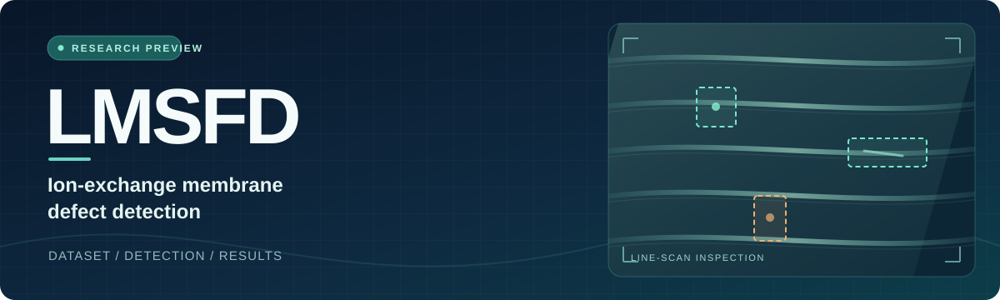

  

  <h1>LMSFD</h1>
  
<strong>A Lightweight Multi-Scale Feature-Decoupled Network for Ion-Exchange Membrane Defect Detection</strong>

  
Industrial visual inspection &nbsp;·&nbsp; Multi-scale defects &nbsp;·&nbsp; Lightweight detection

---

Flexible ion-exchange membranes present low-contrast defects that vary widely in size and often appear together. **LMSFD** separates spatial and semantic feature refinement before cross-scale fusion. This page shares a preview of the **IM11-DET** dataset and selected detection results.

> [!NOTE]
> **Code release:** The source code will be made available after the paper is accepted.

## At a glance

| IM11-DET | Evaluation | LMSFD on the held-out batch |
| :---: | :---: | :---: |
| **1,843** images · **8,514** instances **11** defect categories | **4** production batches for training **1** batch held out for validation | **87.3%** AP50 · **71.6%** AP50–95 **10.2M** parameters |

## Figures

### 01 &nbsp; Dataset and imaging system

Six representative samples, the roll-fed line-scan setup, category-wise instance counts, and defect-size distribution in IM11-DET.

Figure 1 · IM11-DET dataset overview. Click to view at full resolution.

### 02 &nbsp; Quantitative comparison

LMSFD is compared with 11 other detectors across eight metrics. The radar plot normalizes each metric across methods; the right panel shows gains over the RT-DETR baseline in percentage points.

Figure 2 · Performance comparison on IM11-DET. Click to view at full resolution.

### 03 &nbsp; Qualitative comparison

Predictions from LMSFD and five representative detectors on four IM11-DET images. Orange solid boxes mark ground truth; red, yellow, and green dashed boxes mark false positives, false negatives, and true positives, respectively.

Figure 3 · Detection examples. Click to view at full resolution.

