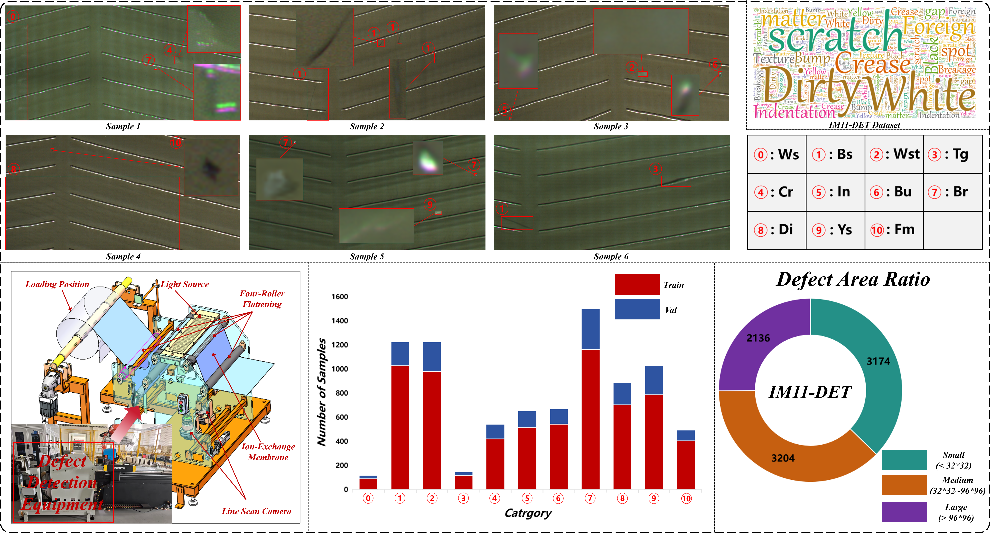
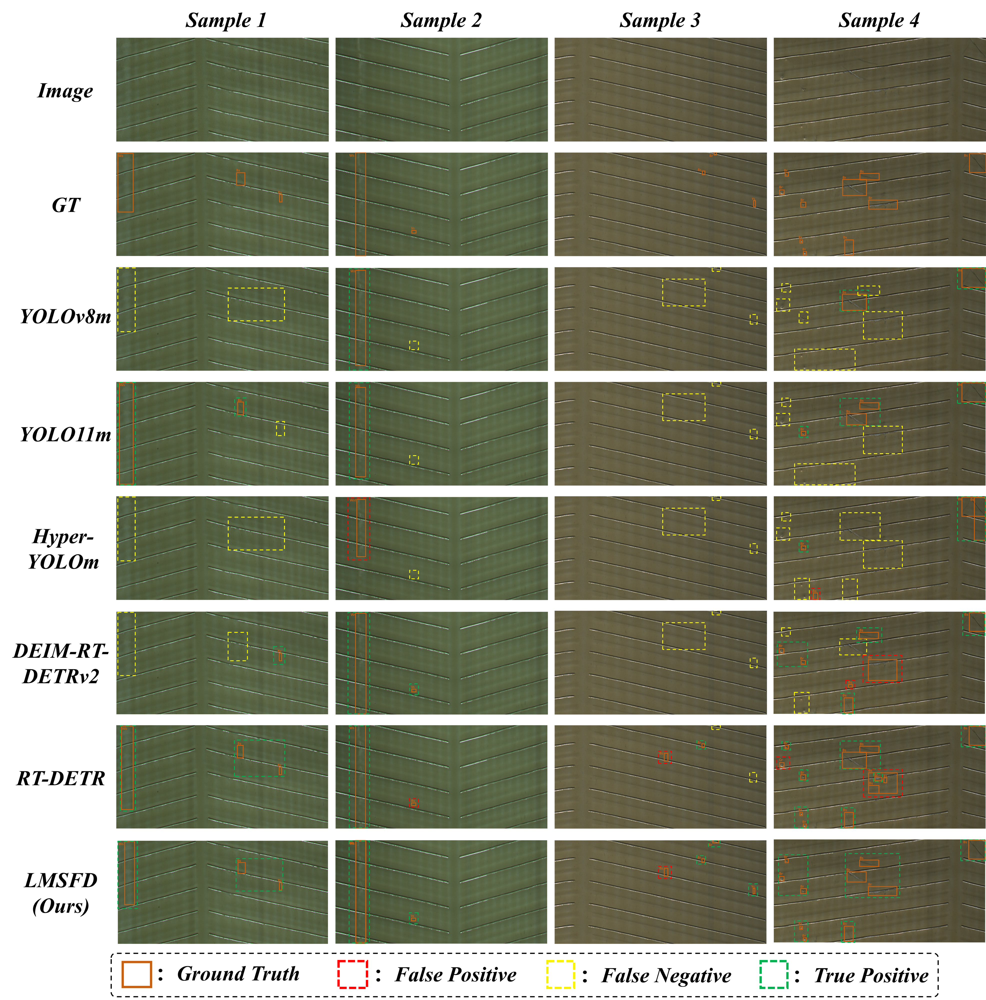
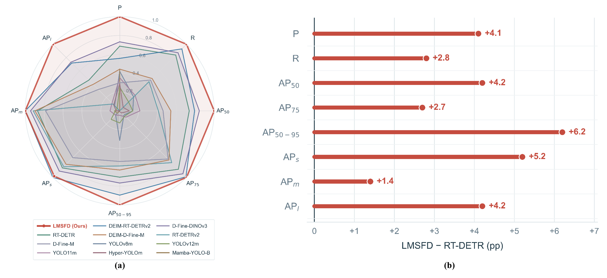

# LMSFD: A Lightweight Multi-Scale Feature-Decoupled Network for Ion-Exchange Membrane Defect Detection

This repository presents selected figures from our work on visual defect detection for ion-exchange membranes. We introduce **LMSFD**, a lightweight detector designed to improve localization and recognition of defects with different sizes and appearances. We also construct **IM11-DET**, an industrial membrane-defect dataset collected with a roll-fed line-scan imaging system.

> **Code availability:** The source code will be released after the paper is accepted.

## Overview

- **IM11-DET:** 1,843 images, 8,514 annotated defect instances, and 11 defect categories.
- **Evaluation:** Four production batches are used for training and a fifth batch is held out for validation.
- **Selected result:** LMSFD achieves 87.3% AP50 and 71.6% AP50–95 on the held-out batch with 10.2 million parameters.

## Figures

### IM11-DET dataset

Representative samples, the imaging setup, category-wise instance counts, and defect-size distribution.

### Qualitative detection results

Examples comparing LMSFD with five representative detectors on four IM11-DET images. Orange solid boxes show ground truth; red, yellow, and green dashed boxes indicate false positives, false negatives, and true positives, respectively.

### Quantitative comparison

Performance across eight metrics compared with 11 other detectors. The right panel shows LMSFD's gains over the RT-DETR baseline in percentage points.

